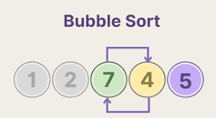
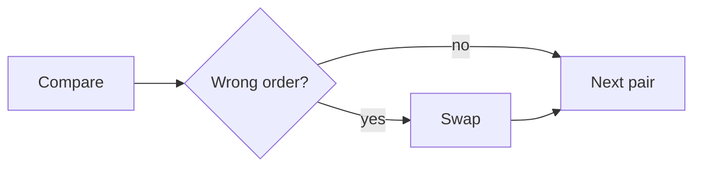

# Bubble Sort 🫧



**Bubble sort** compares neighbouring elements and swaps them if they are in the wrong order.
The biggest element "bubbles up" to the end after each pass.

## How It Works

1. Compare the first two elements.
1. Swap them if the first one is bigger.
1. Move one step right and repeat.
1. Start a new pass until nothing gets swapped :tada:.



## Code

```python
def bubble_sort(items):
    n = len(items)
    for i in range(n - 1):
        for j in range(n - 1 - i):
            if items[j] > items[j + 1]:
                items[j], items[j + 1] = items[j + 1], items[j]
    return items

print(bubble_sort([5, 1, 4, 2, 8]))  # [1, 2, 4, 5, 8]
```

## Complexity

| Case    | Time     |
|---------|----------|
| Best    | `O(n²)`  |
| Average | `O(n²)`  |
| Worst   | `O(n²)`  |

## Pros and Cons

- :+1: Easy to understand
- :+1: No extra memory needed
- :-1: Slow on big lists :snail:

Learn more on [Wikipedia](https://en.wikipedia.org/wiki/Bubble_sort).
